# PersonalHealthMiniProgram
个人健康小程序 系统亮点： AI问答、智能饮食推荐 、Echarts图形化分析、个性化健康闭环 、主动健康提醒  ； 

所有源码均本人开发，项目是前后端分离的，所有的项目都具备了完整的业务逻辑，不仅仅局限于基础的增删改查（CRUD）操作，系统亮点众多。

本文注重于计算机毕业设计选题指导，列出题目均有源码， 大家可以去【公众号】(毕业终点站)获取或者加我【qq】(2112698948)提意见(别忘记Star哟)。备注：git

声明：仅用于学习使用，请勿用于任何商业行为！

1.系统非商用，非开源，非无偿。

2.由本人开发，如需源码，请联系以下方式，qq:2112698948。

3.项目有很多，并未全部上传，如果未找到想要的，可直接咨询。

# 个人健康小程序（AI 问答 · 智能饮食推荐 · ECharts 图形化分析 · 主动健康提醒）

> 本仓库为「个人健康小程序」毕业设计项目的展示文档，截图存放于仓库 `images/` 目录，不依赖外部图床。

## 一、项目简介

个人健康小程序是一款面向普通用户的健康管理工具，结合 AI 问答、智能饮食推荐、图形化数据分析和主动健康提醒等能力，帮助用户记录饮食、饮水、健康指标与体检数据，并由管理员在 Web 后台维护食物库、饮食方案与行为分析规则。系统采用微信小程序 + Vue 管理后台的前后端分离架构，普通用户与管理员双角色权限管理。

## 二、技术架构

| 类别 | 主要技术与职责 |
| :--- | :--- |
| 架构 | B/S、MVC、前后端分离、微信小程序端+管理后台、管理员与普通用户双角色权限管理 |
| 系统环境 | Windows |
| 开发环境 | IDEA、JDK17、Maven、MySQL、Node.js、微信开发者工具 |
| 后端技术 | Java、Spring Boot 3、Spring MVC、MyBatis-Plus、MySQL、JWT、DeepSeek API、扣子 API、阿里云 OSS、微信小程序授权登录 |
| 后台技术 | Vue 3、Vite、Element Plus、Vue Router、Pinia、Axios、ECharts、ECharts WordCloud |
| 小程序技术 | uni-app、Vue 3、Pinia、微信小程序 API、uni-ui 组件 |

## 三、系统亮点

1. **AI问答**
2. **智能饮食推荐**
3. **Echarts图形化分析**
4. **个性化健康完整链路**
5. **主动健康提醒**

## 四、功能截图

### 平台总览

**图 1 · 平台总览**

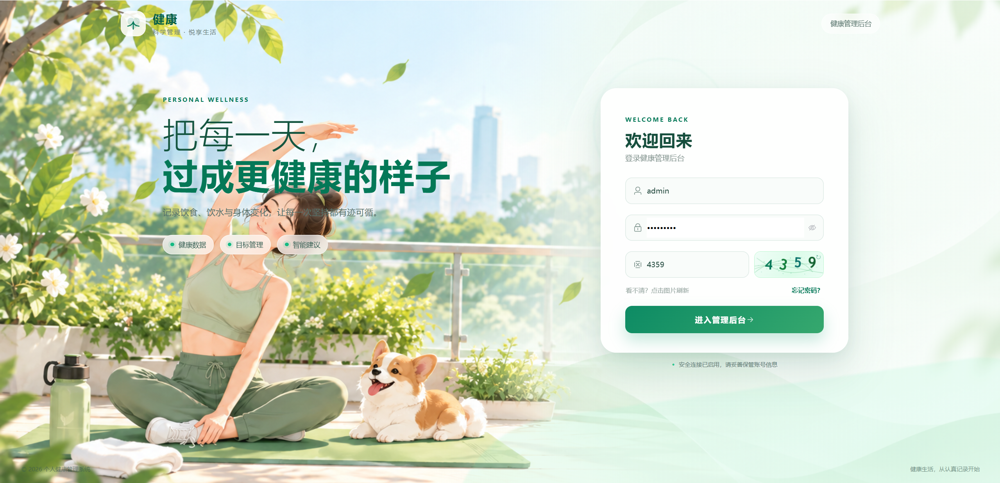

**图 2 · 平台总览**

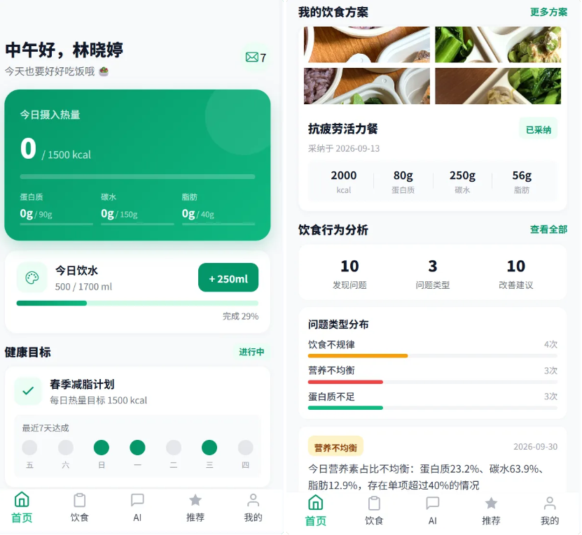

**图 3 · 平台总览**

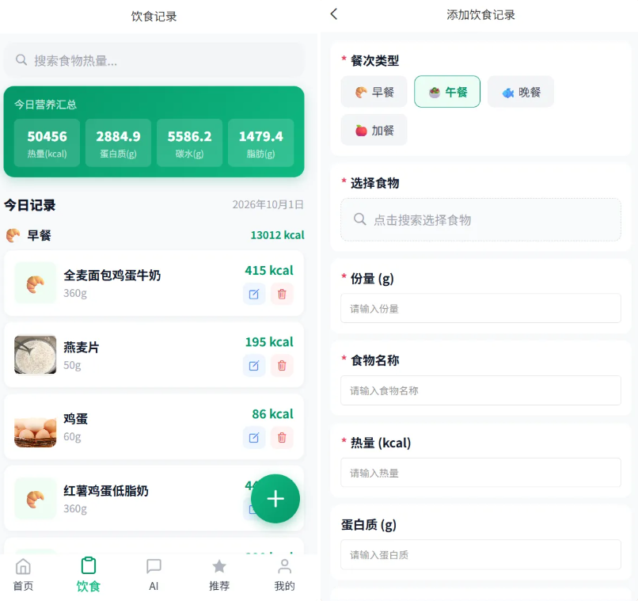

**图 4 · 平台总览**

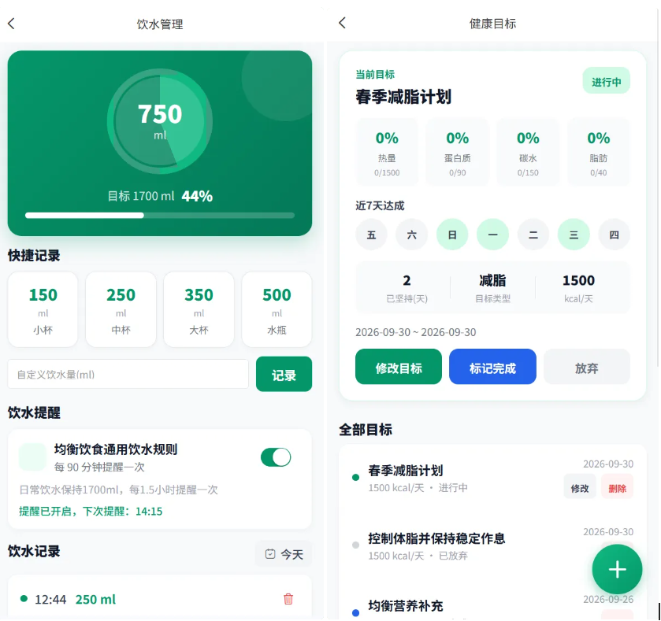

**图 5 · 平台总览**

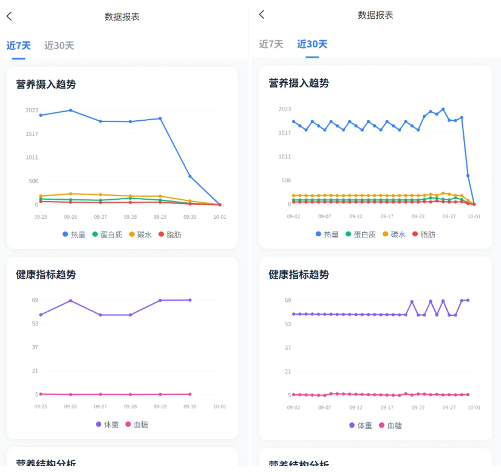

**图 6 · 平台总览**

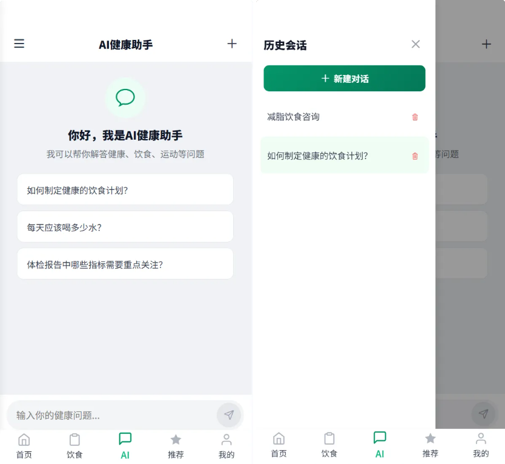

**图 7 · 平台总览**

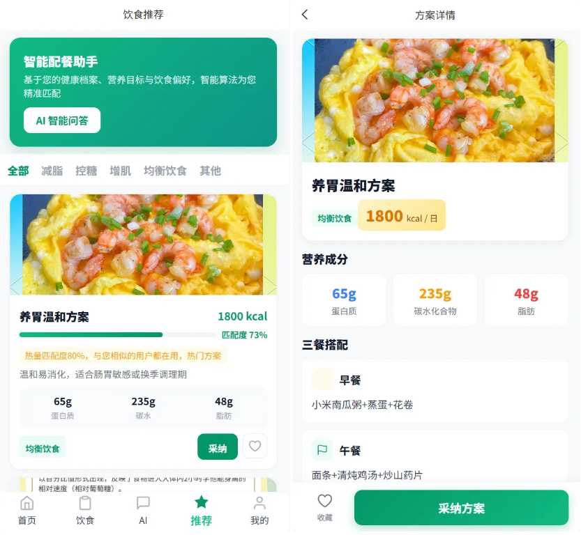

**图 8 · 平台总览**

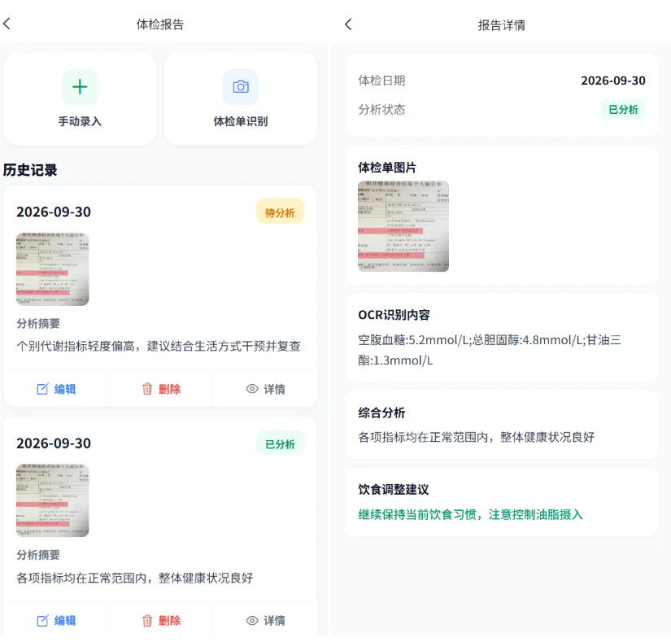

**图 9 · 平台总览**

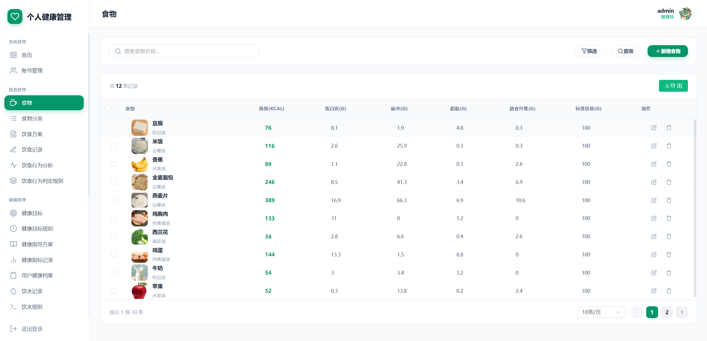

**图 10 · 平台总览**

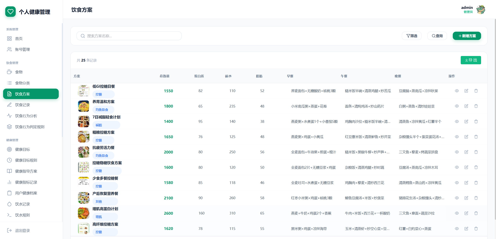

**图 11 · 平台总览**

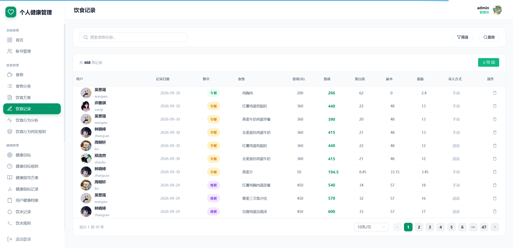

**图 12 · 平台总览**

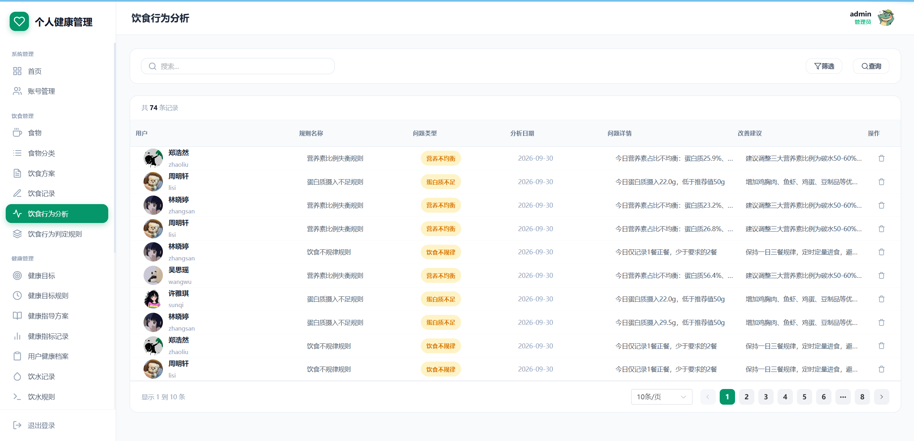

**图 13 · 平台总览**

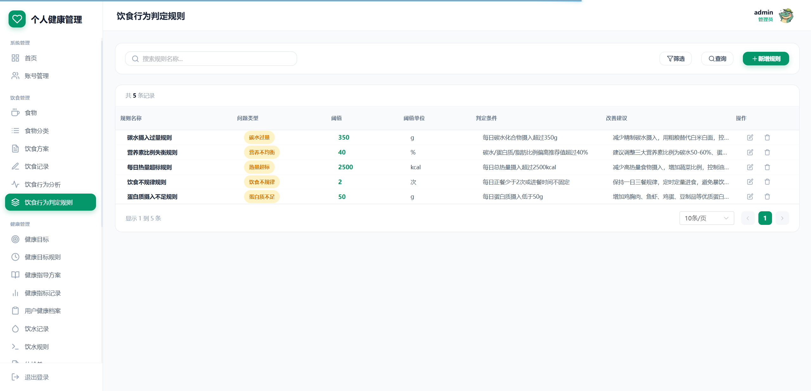

**图 14 · 平台总览**

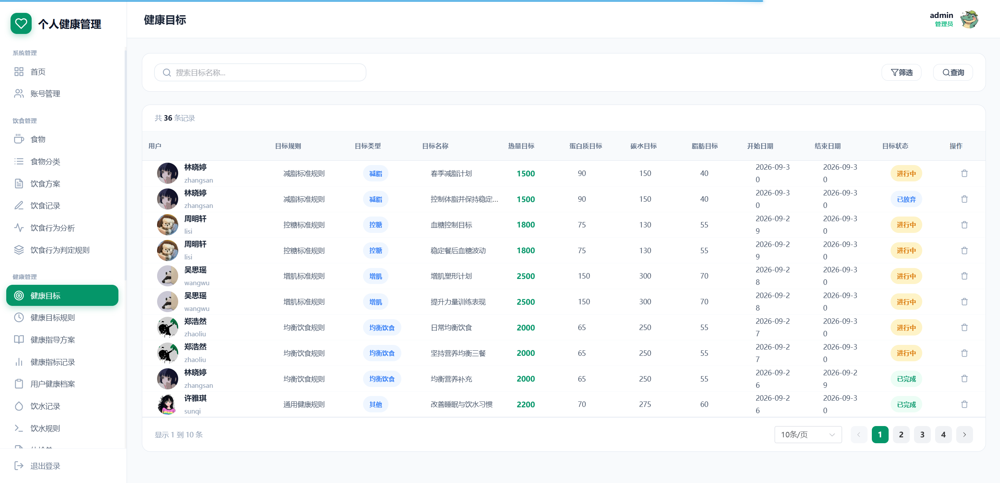

**图 15 · 平台总览**

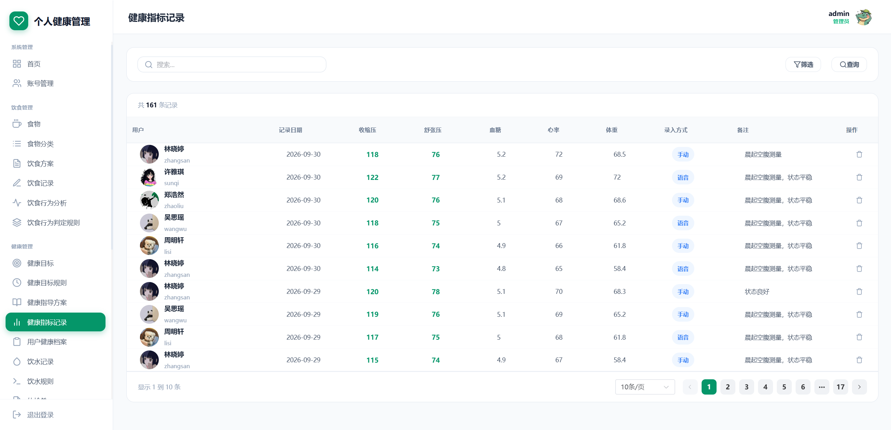

**图 16 · 平台总览**

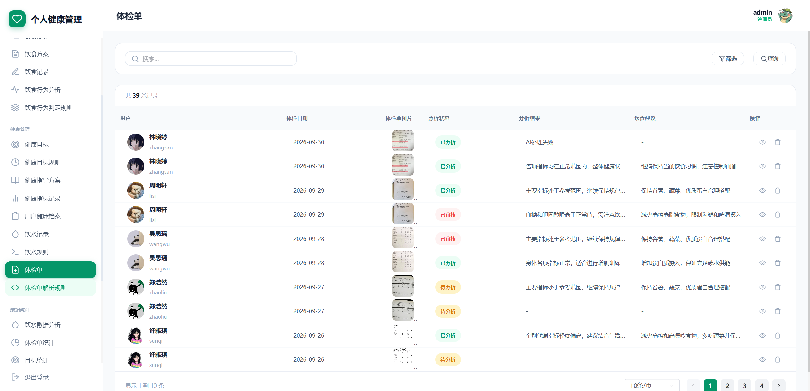

**图 17 · 平台总览**

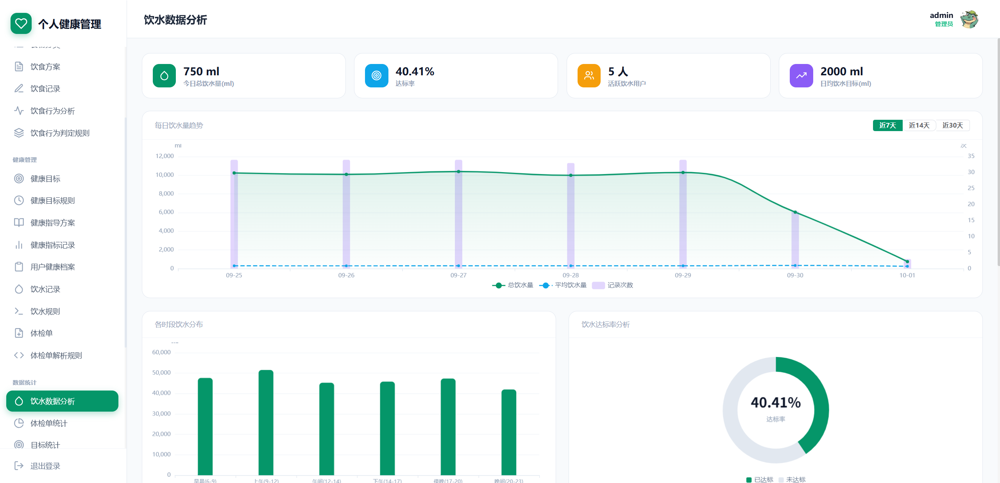

**图 18 · 平台总览**

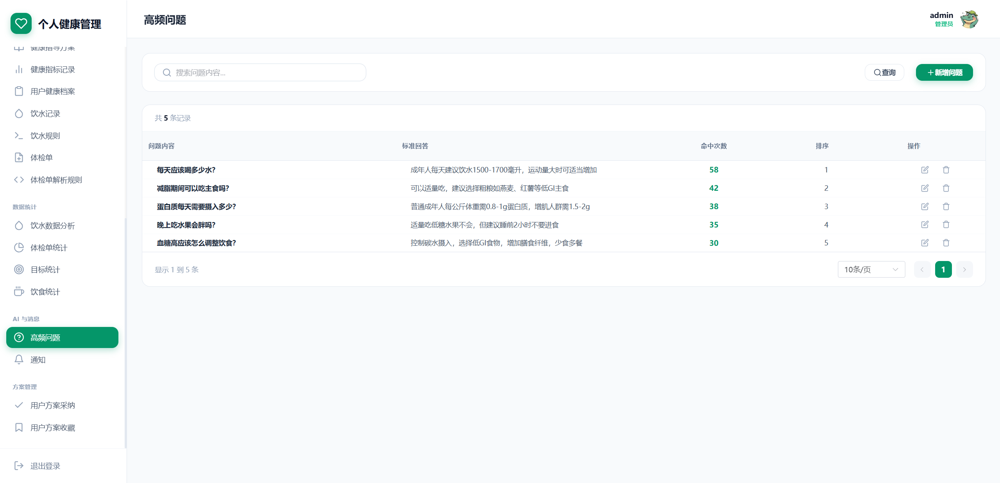

### 用户端

### 管理员端

---

> 免责声明：本文档中的系统截图与说明仅用于毕业设计成果展示与技术交流，部分界面数据为演示用途。

> 本项目仅用于学习交流，非商用、非开源、非无偿。

> 文档展示 18 张截图，需要了解更多，请联系我。
